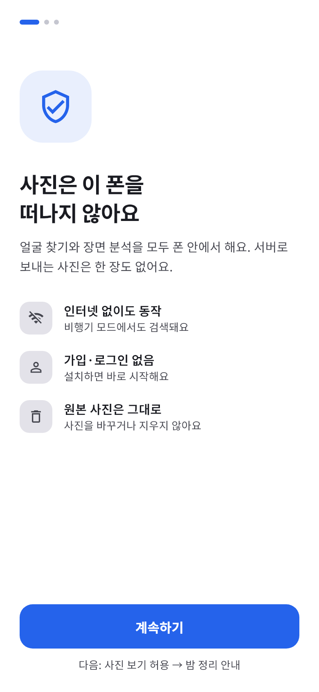
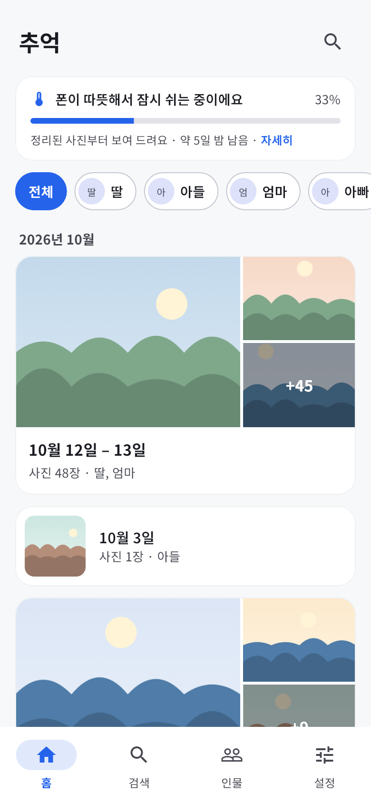
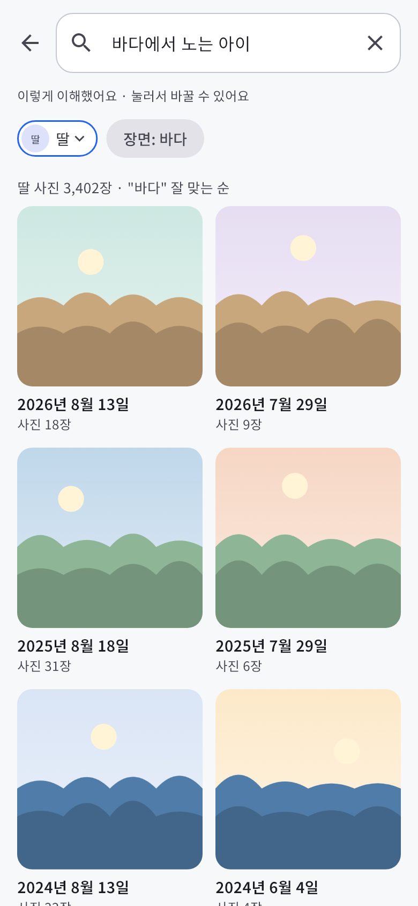
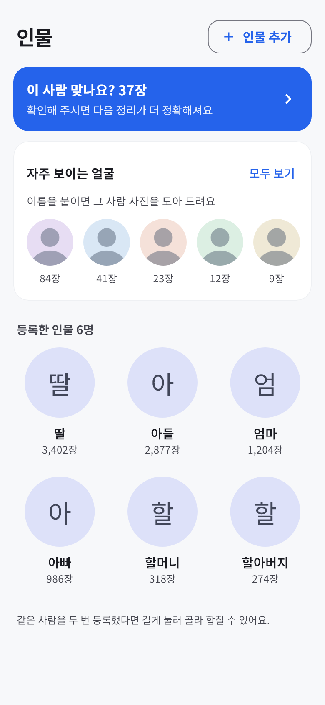
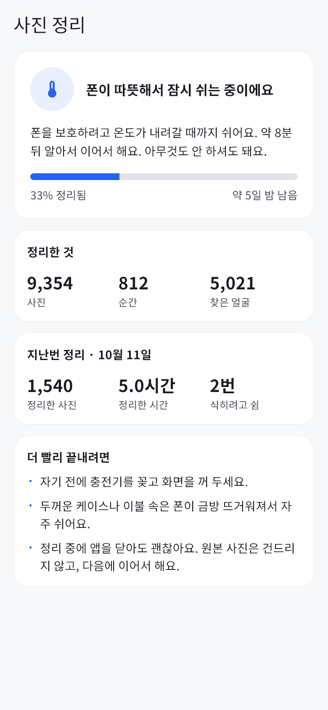
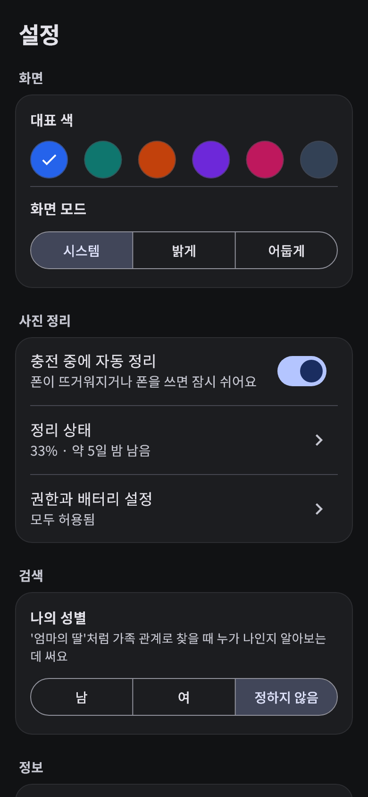

# Photo Tracer

폰 안의 사진을 인터넷 없이 기기에서 분석해, 가족 구성원·일(구간)별로 묶고 "작년 여름 아이랑 바닷가"처럼 한국어로 찾는 Android 앱입니다.

사진과 얼굴 정보는 기기 밖으로 나가지 않습니다. 무거운 분석은 폰을 쓰지 않는 충전 중인 밤에 조금씩 나눠서 합니다.

## 화면

<table>
<tr>
<td align="center"><br>처음 실행: 개인정보 약속</td>
<td align="center"><br>홈: 날짜별 순간, 인물로 거르기</td>
<td align="center"><br>검색: 이해한 내용을 칩으로</td>
</tr>
<tr>
<td align="center"><br>인물: 확인할 사진, 자주 보이는 얼굴</td>
<td align="center"><br>정리 상태: 쉬는 이유와 남은 밤</td>
<td align="center"><br>설정: 대표 색·어두운 화면</td>
</tr>
</table>

그림은 실제 화면 코드를 예시 데이터로 그린 것입니다(`app/test/readme_screens_test.dart`). 사진 자리는 만든 풍경 그림, 인물은 관계 이름이라 가족 사진은 들어 있지 않습니다.

- **처음 실행**: 개인정보 약속 → 권한마다 왜 필요한지(샤오미·삼성 전용 안내 포함) → 충전 중인 밤에 정리하는 방법
- **홈**: 시간 구간을 "순간" 카드로 보여 줍니다. 구간은 갤러리를 읽자마자 생겨서 첫날부터 보이고, 얼굴·장면은 밤마다 늘어납니다.
- **검색**: "바다에서 노는 딸", "엄마의 딸"처럼 한국어로 찾습니다. 인물 칩을 눌러 누구로 볼지 바꿀 수 있습니다.
- **인물**: 사용자가 고른 얼굴과 닮은 얼굴을 찾고, 확실하지 않은 얼굴은 "이 사람 맞나요?"에서 한 장씩 확인합니다.
- **정리 상태**: 지금 정리 중인지, 폰이 뜨거워 쉬는지, 폰을 써서 멈췄는지를 쉬운 말로 알려 주고 남은 밤 수를 지난 밤 처리량으로 셉니다.

## 진행 상황

| 단계 | 내용 | 상태 |
|---|---|---|
| 0단계 | 모델·방식 검증 (PC 평가 + 실제 폰 측정) | 완료 |
| 1단계 | Android MVP | 진행 중 — 밤 정리·검색·인물을 실제 폰에서 시험, 출시용 화면 완성(위). 남은 일: 광고, 분석 결과 지우기, 앱 이름 |
| 2단계 | iOS | 예정 |

## 0단계에서 확인한 것

실제 가족 갤러리(사진 자체는 저장소에 없음)와 보급형 폰(Redmi, MediaTek MT6769, Android 14)으로 측정했습니다.

- **구간 나누기**: 촬영 시각·위치로 사진을 "같은 일" 단위로 나눈다(3시간 간격 + 1km). 애매한 경계는 SigLIP 이미지 유사도로 판단하고, 기준선 근처만 사용자에게 묻는다(사람 판정 98개 기준 자동 판단 83% 정확).
- **대표 사진만 분석**: 구간마다 시간상 고르게 몇 장을 고르고 중복·흔들림·노출 불량은 가까운 사진으로 바꾼다. AI 없이 고른 쪽이 정교한 방식과 눈가림 비교에서 동등 이상이었다.
- **한국어 자연어 검색**: [SigLIP 2 한국어 축소판](https://huggingface.co/alphaedge-ai/siglip2-base-patch16-512-kor-32768)을 ONNX로 바꿔 가중치 8비트로 양자화. 사람이 확인한 구간 설명 560개로 검색하면 상위 5 안에 맞는 구간이 68.8%, 같은 달로 좁히면 97.0%.
- **폰 속도**: 384px 입력, 장당 3.4초(원본 디코딩 포함). 512px는 6.6초인데 정확도 차이가 없어 384px로 정했다.
- **긴 작업**: 중간 저장 후 이어 하기, 충전 중 발열(배터리 42℃, 발열 경고 없이 속도 저하)을 실측했다.

## 저장소 구성

| 경로 | 내용 |
|---|---|
| `poc/` | PC 검증 스크립트 (Python, `uv`) — 얼굴 검출·인식 평가, SigLIP 변환·양자화 비교, 구간 나누기, 대표 사진, 검색 평가, 폰 측정 조작 |
| `bench_app/` | 폰 측정 앱 (Flutter + Kotlin, onnxruntime-android, ML Kit) |
| `app/` | 앱: 충전 중 밤에 얼굴·장면 분석(WorkManager + 포그라운드 서비스, 발열 시 쉼) → 홈(순간)·검색·인물·설정. 분석은 Kotlin(`android/app/src/main/kotlin`), 화면은 Flutter(`lib/ui/`) |

평가용 사진·라벨·결과(`eval_data/`)와 모델 가중치(`poc/models/`)는 개인정보와 용량 때문에 저장소에 넣지 않습니다.

## 실행

```powershell
cd poc
uv sync
uv run download_models.py      # 얼굴 검출·인식 모델 (OpenCV Zoo)
uv run export_siglip.py        # SigLIP 2 → ONNX 변환·양자화
uv run phone_bench.py --help   # 폰 측정 (adb 연결 필요)

# 미니 앱
uv run app_assets.py build     # 모델·토크나이저를 app assets로, 토크나이저 정답 파일 생성
cd ..\app\android
.\gradlew.bat :app:testDebugUnitTest   # Kotlin 토크나이저 = Python 토크나이저 (토큰 id까지)
cd ..
flutter test                   # 화면마다 가짜 데이터로 그려 보기 (좁은 화면·큰 글씨 넘침 포함)
flutter build apk --release --target-platform android-arm64

# README 화면 그림 다시 만들기 (Noto Sans KR 글꼴 필요, 기본 C:\Windows\Fonts\NotoSansKR-VF.ttf)
$env:SCREENS='1'; flutter test test/readme_screens_test.dart; $env:SCREENS=$null
```

## 쓰는 모델과 라이선스

| 모델 | 용도 | 라이선스 |
|---|---|---|
| [YuNet](https://github.com/opencv/opencv_zoo/tree/main/models/face_detection_yunet) | 얼굴 검출 (PC) | MIT |
| [SFace](https://github.com/opencv/opencv_zoo/tree/main/models/face_recognition_sface) | 얼굴 인식 | Apache 2.0 |
| [SigLIP 2 한국어 축소판](https://huggingface.co/alphaedge-ai/siglip2-base-patch16-512-kor-32768) | 장면 이해·검색 | Apache 2.0 |
| ML Kit 얼굴 검출 | 얼굴 검출 (폰) | Google ML Kit 약관 |

## 라이선스

[Apache License 2.0](LICENSE)
